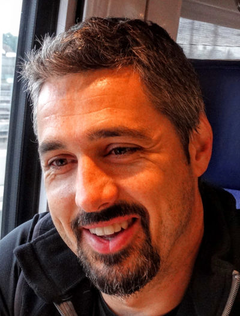

{: .hero-photo}

# Cédric Wemmert

{{ site.description }}
{: .hero-tagline}

Full professor in Computer Science, head of the [SDC team](https://sdc.icube.unistra.fr/en/index.php?title=Home) of the [Engineering, Computer and Imaging Sciences Laboratory](https://icube.unistra.fr) of the [University of Strasbourg](https://unistra.fr)
{: .lead}

Member of [CNU 27](https://cnu27.ls2n.fr/)

**Keywords**: data science, machine learning





<!-- {:.openposition}
**2023/09 - Open position:** Postdoc on *Multimodal deep learning for mass spectrometry data and histopathological images analysis* - [find out more here](./assets/files/2023_MAIA_postdoc.pdf)
-->

* * *

## Research

<!-- Each 
 gets a coloured band on its left (_sass/site.scss). -->

### Current projects and collaborations



Past activities



### Research supervision

#### Current PhD researchers



Graduated



Postdocs and engineers



### Publications

[Browse the complete list of my publications](./publications/){: .main}, with abstracts, BibTeX entries and PDFs (also available on [HAL](https://cv.hal.science/cedric-wemmert)).

* * *

## Teaching

I am teaching mainly in the Computer Science department of the [Technology Institute Robert Schuman](https://iutrs.unistra.fr) of the [University of Strasbourg](https://unistra.fr).

* Web services with JEE (also taught at [ENSISA](http://www.ensisa.uha.fr/accueil/etudes/ecole-ingenieur-informatique-et-reseaux/))
* Introduction to networks
* Networks programming
* Graph theory
* Discrete mathematics

* * *

## What is my job?

> When you’re fundraising, it’s AI
> 
> When you’re hiring, it’s ML
> 
> When you’re implementing, it’s linear regression
> 
> When you’re debugging, it’s printf()
